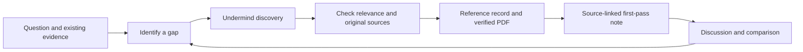

# Literature workflow with Undermind

Use Undermind when a task needs additional scholarly literature or analysis of PDFs already available in the service. Read an existing local paper directly when it already answers the question. The reference manager keeps selected original papers and citation records; the user's note system keeps verified understanding. This is an optional route, not a required installer profile.

## Connect and choose the workspace

Inspect tools actually exposed by the host. Call `get_orientation` before other Undermind tools in a new conversation, then `list_workspaces`. Choose the workspace for this research task; create one when the user has authorized that scope. Record its name, ID, and link in the private project configuration, not the shared workbench source. Keep credentials in the service's official sign-in flow.

The tools operate on the global literature and workspace content. A workspace contains papers, available PDFs, searches, files, and folders. Cite keys such as `Unr20` are specific to that workspace; they are different from a DOI, Zotero item key, or the citation key used in a manuscript. Record mappings when handing a selected paper between systems.

## Route the current question

| Need | Undermind route | Check before relying on it |
| --- | --- | --- |
| Known paper or supplied reference | `lookup_papers_by_metadata` with DOI/title | Verify title, authors, year, and DOI |
| A few papers on a defined question | `search_papers`, semantic mode | Explain the relevance and access scope |
| Earlier sources or later work around a seed | `search_papers`, references/citations mode | Semantic selection may omit papers; this is not a complete bibliography export |
| A particular author's work | `find_papers_by_author` | Disambiguate identity using known papers and topic |
| A broader literature review | Inspect existing searches, then `launch_deep_search` if needed | Give a self-contained research goal; retain selection reasons and coverage limits |
| Questions about full text | `get_paper_info` for PDF status, then `read_pdfs` | Ask focused questions; check decisive passages, figures, and equations in the original |
| Available PDF for local use | `get_pdf_download_links` | Verify the downloaded PDF before saving it in the reference manager |

Read current tool schemas rather than guessing arguments. Reference/citation modes need a seed cite key and a semantic query. Deep search operates on abstracts and citation relationships; it does not establish the correctness of full-text claims. The service attempts open-access retrieval, but a PDF-available indicator is not proof that every claimed result has been checked. Missing PDFs may be obtained through lawful open versions or existing institutional access. Upload local files only within the user's authorization.

Use service display tools for relevant paper or search cards, following their current limits. Do not expose temporary PDF download links or account identifiers in shared reports. If the service is unavailable, use the host's existing academic search and local reading tools; retain the same evidence checks.

## Screen and save selected evidence

For each candidate retained, state the research problem, why it addresses the current gap, and whether the judgment uses metadata, abstract, or full text. Separate the paper's findings from AI explanations and unverified hypotheses. A high search rank or citation count is not evidence of method superiority.

Use DOI plus title/author checks to deduplicate against the user's reference library. The reviewed Undermind interface has no direct Zotero-write tool. Use the existing Zotero connector/API or supported native import for bibliography records. When a record already exists, attach the PDF to that parent rather than creating another record. Save only the selected papers; a search does not authorize copying an entire library.

Verify these separately:

1. The bibliography record identifies the intended paper.
2. The attachment is an actual readable PDF and matches the paper's title/DOI.
3. The PDF belongs to the correct bibliography parent. A URL field or DOI import alone is insufficient.
4. Where a source file is available, compare its bytes/hash with the stored copy to detect a failed or mismatched attachment.

Keep originals in Zotero or the user's chosen library. Create concise notes in the existing note system, with exact source locations for substantive claims and explicit AI first-pass status. Improve the same note after user discussion. For method comparisons, check compatible assumptions, conditions, and metrics before drawing conclusions. A remaining evidence gap can trigger another targeted search; paper count is not an acceptance criterion.

## Record actual acceptance

Keep connection, metadata lookup, search execution, provider-reported PDF status, full-text reading, stored attachment, and note checks as separate results in the user's local configuration. A small public-paper DOI lookup can test the connection without uploading private material; it does not validate search coverage, PDF analysis, or the full workflow. Reopen outputs and check original-source locators before marking a real task verified.

The installer does not install Undermind, sign in, create a subscription, or schedule recurring searches. Follow the user's existing limits for spending, uploads, and scheduling. Record unknown plan limits rather than promising free or unlimited access. Vendor software, service access, and paper rights are separate from the workbench's MIT-licensed integration instructions; see [third-party attribution](../THIRD_PARTY.md).
